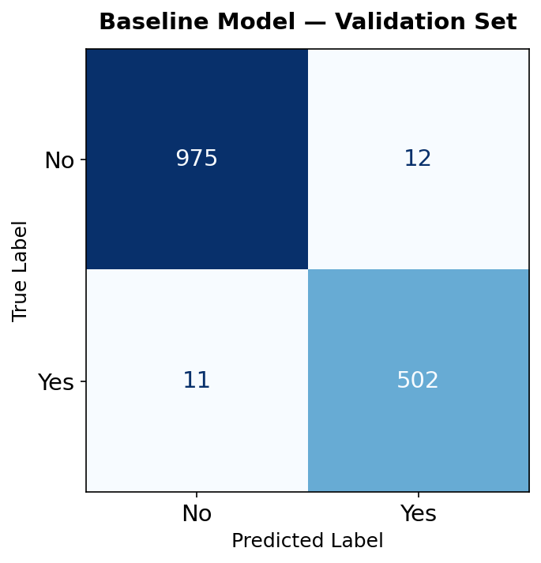
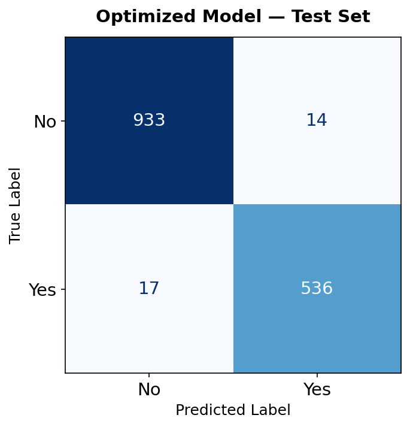

# Hospital Readmission Prediction — Gradient Boosting Classification

A binary classification model predicting whether a hospital patient will be readmitted within 30 days of discharge. Built with a Gradient Boosting Classifier on a mixed-type medical dataset, evaluated against a recall-optimized hyperparameter search, and notable for a counter-intuitive finding: across all metrics, the default model outperformed the tuned model.

> **Note on Dataset Availability**
> The dataset has been removed from this repository for data ethics reasons. All generated confusion matrices and metric outputs are retained in the `output/` folder for reference and portfolio purposes.

---

## Research Question

**Can a patient's clinical and demographic profile predict hospital readmission within 30 days of discharge?**

---

## Why Gradient Boosting

Gradient Boosting builds an ensemble of shallow decision trees sequentially — each tree corrects the residual errors of the previous one. On tabular medical data with mixed feature types (continuous vitals, binary condition flags, one-hot encoded categorical fields), it consistently outperforms linear classifiers without requiring distributional assumptions.

The sequential error-correction mechanism makes it particularly effective when the minority class (readmitted patients) carries the highest cost, because each iteration can concentrate on the examples previous trees misclassified.

---

## Why Recall — Not Accuracy

In healthcare classification, metric choice is a clinical decision, not a technical preference.

A false negative here means predicting "no readmission" when a patient will actually be readmitted. That patient leaves without follow-up care scheduled. A false positive adds an unnecessary check-in. The cost asymmetry is not ambiguous.

This makes **Recall** the correct optimization target:

- **Accuracy** is distorted by class imbalance — a model predicting "No" for every patient can score 60–70% accuracy while being completely useless.
- **F1** balances precision and recall equally, which is inappropriate when one type of error is substantially more costly.
- **Recall** explicitly minimizes false negatives — the metric directly aligned with the clinical objective.

All hyperparameter tuning via GridSearchCV used `scoring="recall"`.

---

## Analysis Pipeline

1. Load raw dataset; drop administrative and geographic columns
2. Encode the binary target (`ReAdmis`: Yes → 1, No → 0)
3. Encode 12 binary medical condition columns (Yes → 1, No → 0)
4. One-hot encode nominal categorical features with `drop_first=True`
5. Three-way split: **70% train / 15% validation / 15% test**
6. Train baseline Gradient Boosting model (default hyperparameters) → evaluate on validation set
7. Run GridSearchCV (5-fold CV, scoring=recall) across 16 hyperparameter combinations
8. Evaluate best model on held-out test set

---

## Feature Engineering Decisions

**Dropped columns:** `CaseOrder`, `Customer_id`, `Interaction`, `UID`, `City`, `State`, `County`, `Zip`, `Lat`, `Lng`, `Population`, `TimeZone`, `Job`

These are administrative identifiers, geographic coordinates, or high-cardinality string fields. Including geographic coordinates would introduce data leakage (location is not a causal readmission predictor). The `Job` column produces hundreds of sparse dummy variables that increase noise without adding signal.

**Binary encoding:** 12 medical condition columns mapped to 0/1 integers rather than kept as strings. This prevents the model from treating category names as ordered values while avoiding dummy variable expansion for already-binary features.

**`drop_first=True` on categorical encoding:** Removes one dummy variable per category group to prevent perfect multicollinearity in the feature matrix.

---

## Hyperparameter Grid

```python
PARAM_GRID = {
    "n_estimators":    [100, 200],
    "learning_rate":   [0.05, 0.1],
    "max_depth":       [3, 5],
    "min_samples_split": [2, 5],
}
```

5-fold cross-validation × 16 combinations = **80 model fits**.

**Best parameters found:** `learning_rate=0.1`, `max_depth=5`, `min_samples_split=2`, `n_estimators=200`

---

## Model Performance

| Metric | Baseline (Validation Set) | Optimized (Test Set) |
|---|---|---|
| Accuracy | 0.9847 | 0.9793 |
| Precision | 0.9767 | 0.9745 |
| Recall | 0.9786 | 0.9693 |
| F1 Score | 0.9776 | 0.9719 |
| AUC-ROC | 0.9988 | 0.9979 |
| False Negatives | 11 | 17 |

| Baseline — Validation Set | Optimized — Test Set |
|---|---|
|  |  |

---

## Counter-Intuitive Finding: Baseline Outperforms Tuned Model

Across every metric — including Recall, the metric GridSearchCV was explicitly optimizing — the baseline model outperformed the tuned model. False negatives increased from 11 to 17.

A few things to note about interpreting this comparison:

- The baseline was evaluated on the **validation set**; the tuned model on the **test set**. These are different data splits, so the comparison is not perfectly controlled.
- However, the direction of the result is meaningful: the tuned model does not demonstrably improve on the baseline even on held-out data.

Why does this happen?

GridSearchCV maximizes average recall across 5 training folds. The selected hyperparameters (`max_depth=5`, `n_estimators=200`) produce a more complex model. On the folds it trained on, more complex trees captured more minority-class patterns. On genuinely new data, the added complexity introduced more variance than it resolved — a classic bias-variance trade-off.

The default configuration (`max_depth=3`, `n_estimators=100`) already generalizes well. The simpler model's slightly higher bias turns out to be an advantage on a dataset of this size.

Reporting this result honestly is more useful than selecting the configuration that looks cleaner.

---

## How to Run

```bash
pip install -r requirements.txt
python main.py
```

All preprocessing, model training, evaluation metrics, and confusion matrix figures run automatically. Outputs are saved to `output/`.

---

## Project Structure

```
project/
├── data/                   # Dataset (not included — data ethics)
├── output/                 # Confusion matrices and data splits
├── main.py                 # Entry point — full pipeline
├── requirements.txt
└── README.md
```

---

## Tech Stack

`Python` · `pandas` · `scikit-learn` (`GradientBoostingClassifier`, `GridSearchCV`, `ConfusionMatrixDisplay`) · `Matplotlib`
