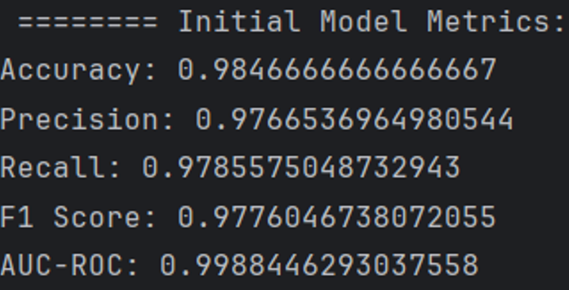
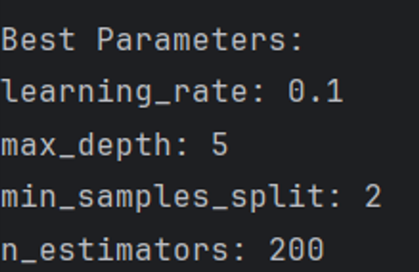

# Patient Readmission Prediction — Gradient Boosting Classifier

This project builds a **Gradient Boosting classification model** to predict whether a patient will be readmitted to the hospital within 30 days of discharge. Using demographic characteristics, medical conditions, and hospitalization details, the model enables hospitals to identify high-risk patients before discharge and implement targeted interventions — reducing readmission rates and avoiding financial penalties.

The analysis covers:

- **Data Preprocessing:** Encoding categorical and binary medical condition variables, dropping irrelevant identifiers, and preparing a clean feature matrix for modeling.
- **Model Training:** Gradient Boosting classifier trained on a 70/15/15 train/validation/test split.
- **Hyperparameter Tuning:** GridSearchCV with 5-fold cross-validation optimizing for recall — prioritized over accuracy because false negatives (missed high-risk patients) carry serious clinical consequences.
- **Model Evaluation:** Initial and optimized models compared using accuracy, precision, recall, F1 score, AUC-ROC, and confusion matrices.

> **Note on Dataset Availability**
> The dataset (`medical_clean.csv`) has been removed from this repository as it contains sensitive medical information and is proprietary. All visualizations and model outputs generated during the analysis are retained in the `output/` folder for reference and presentation purposes.

---

## Why Gradient Boosting

Gradient Boosting builds decision trees sequentially — each tree corrects the errors of the previous one — making it especially effective for healthcare classification where:

- The data contains mixed types (continuous, categorical, binary medical flags)
- Nonlinear interactions between features (e.g., age × diabetes × hospital stay length) matter
- Minimizing false negatives is critical — a patient incorrectly predicted as low-risk is a costly miss

---

## Variables

**Target:** `ReAdmis` (Yes / No → 1 / 0)

**Continuous predictors:** `Age`, `Income`, `VitD_levels`, `Doc_visits`, `Full_meals_eaten`, `VitD_supp`, `Initial_days`, `TotalCharge`, `Additional_charges`

**Categorical predictors:** `Gender`, `Marital`, `Area`, `Initial_admin`, `Complication_risk`, `Services`

**Binary medical conditions:** `HighBlood`, `Stroke`, `Overweight`, `Arthritis`, `Diabetes`, `Hyperlipidemia`, `BackPain`, `Anxiety`, `Allergic_rhinitis`, `Reflux_esophagitis`, `Asthma`, `Soft_drink`

**Excluded:** identifiers (`CaseOrder`, `UID`, `Customer_id`), high-cardinality geographic fields, survey items (Item1–Item8)

---

## Analysis Summary

### Preprocessing Steps
1. Drop irrelevant identifiers and geographic columns
2. Drop rows with missing values
3. Encode target variable (`Yes` → 1, `No` → 0)
4. Encode binary medical condition columns
5. One-hot encode nominal categorical variables
6. Convert boolean columns to integer (0/1)
7. Save processed dataset as `data/medical_clean_processed.csv`

### Data Split

| Set | Size |
|---|---|
| Training | 70% |
| Validation | 15% |
| Test | 15% |

### Initial Model Results (Validation Set)

| Confusion Matrix — Initial Model | Classification Report |
|---|---|
|  |  |

### Hyperparameter Tuning

GridSearchCV with 5-fold cross-validation, optimizing for **recall**.

Parameters tuned:

| Parameter | Values Tested | Effect |
|---|---|---|
| `n_estimators` | 100, 200 | Controls number of boosting trees |
| `learning_rate` | 0.05, 0.1 | Controls each tree's contribution |
| `max_depth` | 3, 5 | Controls tree complexity |
| `min_samples_split` | 2, 5 | Controls node splitting conservatism |

| Best Parameters Output |
|---|
|  |

### Final Model Results (Test Set)

| Confusion Matrix — Final Model |
|---|
|  | 


### Model Comparison

| Metric | Initial Model | Optimized Model |
|---|---|---|
| Accuracy | 0.98 | 0.97 |
| Precision | 0.97 | 0.97 |
| Recall | 0.97 | 0.96 |
| F1 Score | 0.97 | 0.97 |
| AUC-ROC | > 0.99 | > 0.99 |
| False Negatives | 11 | 17 |

> The initial model slightly outperformed the optimized model on recall, suggesting the dataset was already well-suited for the base configuration. The increase in false negatives in the optimized model is the key clinical concern — future work should explicitly optimize for recall from the start.

---

## How to Run

### Prerequisites

```bash
pip install -r requirements.txt
```

### Dataset Setup

Place the dataset inside the `data/` folder:

```
project/
├── data/
│   └── medical_clean.csv       ← put it here
├── main.py
├── requirements.txt
└── README.md
```

### Run

```bash
python main.py
```

The script handles all preprocessing, training, tuning, evaluation, and visualization steps automatically. All outputs and plots are saved to the `output/` folder.

---

## Project Structure

```
project/
├── data/                            # Raw dataset (not included — see note above)
├── output/                          # Confusion matrices, ROC curve, feature importance, processed CSV
│   └── medical_clean_processed.csv
├── main.py                          # Entry point — run this
├── requirements.txt
└── README.md
```

## Key Libraries

| Library | Purpose |
|---|---|
| `pandas` | Data loading, cleaning, encoding |
| `scikit-learn` | Gradient Boosting, GridSearchCV, metrics, train/test split |
| `matplotlib` / `seaborn` | Confusion matrix, ROC curve, feature importance plots |
